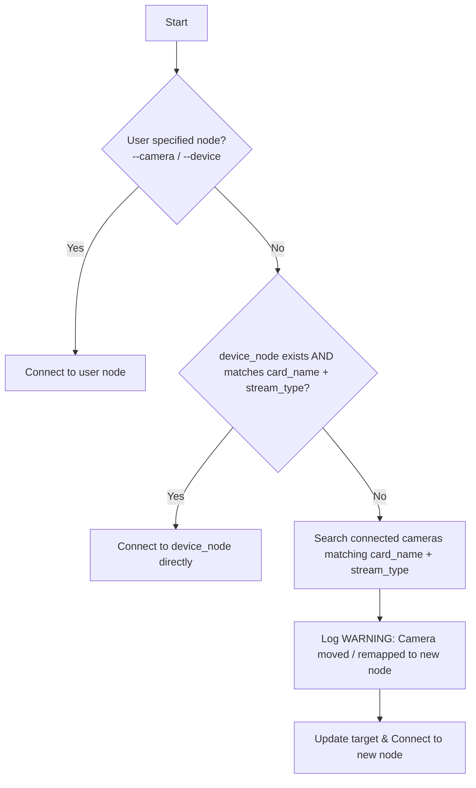

# Calibration NPZ Parameters & Camera Discovery

NPZ file output generated by `calibrator` (e.g. `output/<name>/camera_calibration.npz`).

---

## 1. NPZ Archive Keys

| Key | Type / Shape | Description |
|---|---|---|
| `camera_matrix` | `(3, 3) float64` | Intrinsic matrix: `[[fx, 0, cx], [0, fy, cy], [0, 0, 1]]` |
| `dist_coeffs` | `(5,)` / `(8,) float64` | Distortion: radial `[k1, k2, k3]` + tangential `[p1, p2]` |
| `image_size` | `(2,) int64` | Resolution: `[width, height]` |
| `rms_error` | `float64` | Reprojection error in px (target: `< 1.0 px`) |
| `camera_name` | `str` | Profile name (e.g. `"astra1392"`) |
| `card_name` | `str` | V4L2 device name (e.g. `"Astrap: Astrap"`) |
| `device_node` | `str` | Recorded V4L2 node (e.g. `"/dev/video2"`) |
| `stream_type` | `str` | Stream format: `"Color (MJPEG)"`, `"RGB / Color"`, `"Depth"`, etc. |

---

## 2. Camera Connection & Node Resolution (Agent Rules)

When connecting downstream to a camera:



### Precedence:
1. **User Override:** If user passes `--camera <node>` or `device_node_override`, use it directly. Never override explicit user input.
2. **Exact Node + Stream Match:** Check if `device_node` exists AND its active camera matches both `card_name` and `stream_type`.
3. **Card Name + Stream Type Fallback Search:** If the node does not exist or its stream type doesn't match (e.g. RealSense RGB vs Depth):
   - Search across all connected V4L2 streams for the one matching **both `card_name` AND `stream_type`**.
   - Log a `WARNING`: `[CAMERA MOVED / RE-MAPPED] Camera '<name>' (Stream: '<stream>') node changed from '/dev/videoX' -> '/dev/videoY'`.
   - Connect to the resolved node.

---

## 3. Quick Usage Examples

### Python (Using calibrator loader):
```python
from calibrator import load_calibration

calib = load_calibration("astra1392", stream_type="Color (MJPEG)")

# Resolves live device node, checks card_name + stream_type, logs if moved:
resolved_node = calib.resolve_live_device_node()

# Or open stream directly with automatic resolution and warnings:
cap, (w, h) = calib.open_stream(device_node_override=user_arg)
```

### Python (Standalone NumPy):
```python
import numpy as np, cv2, logging
from calibrator.sync_devices import find_matching_stream, enumerate_v4l2_streams

log = logging.getLogger("camera")
data = np.load("output/rl720/camera_calibration.npz")
K, D, (w, h) = data["camera_matrix"], data["dist_coeffs"], data["image_size"]
recorded_node = str(data["device_node"])
card_name = str(data["card_name"])
stream_type = str(data["stream_type"])

# Resolve node: verify both card name and stream type match
connected = enumerate_v4l2_streams()
matched = find_matching_stream(
    target_card_name=card_name,
    target_stream_type=stream_type,
    target_resolution=(int(w), int(h)),
    connected_streams=connected
)

if matched:
    if matched.device_node != recorded_node:
        log.warning(f"[CAMERA MOVED] {card_name} ({stream_type}) moved: {recorded_node} -> {matched.device_node}")
    target_node = matched.device_node
else:
    target_node = recorded_node

cap = cv2.VideoCapture(target_node)
```

